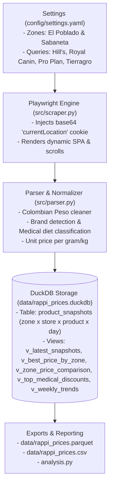

# Rappi Pet Food Price Tracker & Analytics (Medellín)

A weekly automated price scraping and analytics pipeline for pet food (specialized and veterinary diets) across **Medellín (El Poblado & Sabaneta)** on **Rappi Colombia**, backed by **DuckDB**.

---

## 🏗️ Architecture



### Key Technical Highlight: Hyper-local Geo Injection
Rappi requires a delivery location before displaying prices and availability. Rather than manually solving address prompts on each run, the scraper generates and injects Rappi's URL-encoded, Base64 `currentLocation` cookie for exact latitude/longitude coordinates (Medellín Poblado vs Sabaneta) into the browser context.

### Data model
Rappi search results are grouped **by store** (Turbo, Puppis, Tierragro, Laika...), and the same product is usually sold by several stores at different prices. Every snapshot row is therefore keyed by **day + zone + store + product** (Rappi's own `storeId`/`productId`, read from the `data-qa="product-item-cpgs-<store>_<product>"` attribute). Re-running on the same day overwrites that day's prices.

**Matching the same product across stores.** Stores word names differently ("Hill's Comida Perro Adulto Small Bites" vs "Alimento Hills Small Bites para Perros Adultos"), so each row stores a `product_key`: accents, filler words (alimento, comida, para...), weights and word order are removed and synonyms unified (perros/canine → perro, felino → gato...). Names also often omit the package size, so the views derive `pack_size` from Rappi's unit price (`price / price-per-gram`). Offers are compared only when **product_key and pack_size** both match.

**Relevance filter.** Rappi fuzzy-matches every query (even nonsense returns products, and medical queries return medicines, vaccines and toys). A result is stored only if its name shares at least one normalized word with the query (`ProductParser.is_relevant`).

| View | What it answers |
| :--- | :--- |
| `v_latest_snapshots` | Most recent run per zone (+ derived `pack_size`) |
| `v_best_price_by_zone` | Cheapest vs most expensive store for each product inside a zone |
| `v_zone_price_comparison` | Best price of the same product in each zone (cheapest/priciest zone) |
| `v_top_medical_discounts` | Active promos on veterinary / prescription diets |
| `v_weekly_trends` | Week-over-week price change of the exact same offer (zone + store + product) |

Snapshot dates and ISO week ids use Colombian local time (UTC-5). Older databases are migrated automatically on open: v1 (no store columns) is kept aside in `product_snapshots_legacy_v1`; v2 gets `product_key` added and backfilled.

---

## 📁 Project Structure

```
Personal_Projects/price_scraper_list/
├── config/
│   ├── settings.yaml          # Configurable zones (Poblado, Sabaneta) and search terms
│   └── settings.local.yaml    # PRIVATE, git-ignored: client store, extra zones (optional)
├── src/
│   ├── config.py              # Pydantic models, cookie encoder, private overlay merge
│   ├── database.py            # DuckDB manager, upsert logic & analytical views
│   ├── parser.py              # COP price regex, medical diet detector, unit price, name keys
│   ├── scraper.py             # Playwright: searches, store ranks, store catalog crawl
│   └── client_report.py       # Client pricing + visibility Excel (Spanish)
├── tests/
│   ├── test_parser.py         # Price / discount / pet-type parsing
│   ├── test_database.py       # Upserts, views, legacy migration, cookie encoding
│   └── test_client_report.py  # Product matching, pricing rules, inventory, Excel output
├── analysis.py                # Ready-to-run DuckDB SQL analysis report
├── main.py                    # CLI tool for runs, queries, exports, and stats
├── init.ps1                   # Setup + verification (venv, deps, Chromium, tests)
├── register_task.ps1          # Registers the weekly Windows scheduled task
├── run_weekly.ps1             # Weekly scheduled run (scrape -> export -> stats), logs to logs/
├── requirements.txt           # Locked runtime dependencies
├── requirements-dev.txt       # + pytest
├── AGENTS.md                  # Agent harness: startup, gates, project rules
├── feature_list.json          # Feature status + verification evidence
├── progress.md                # Session log, blockers, next step
├── decisions.md               # Architecture decisions (ADR-001...)
└── README.md
```

---

## 🚀 Quickstart & Usage

### 0. Setup & verification

```powershell
.\init.ps1          # creates .venv, installs deps + Chromium, runs unit tests and stats
.\init.ps1 -Smoke   # additionally scrapes one query in one zone against live Rappi
```

### 1. Run Scraper Manually

```powershell
# Run full weekly extraction (all zones and queries configured in settings.yaml)
.venv\Scripts\python.exe main.py run

# Run only for a specific zone
.venv\Scripts\python.exe main.py run --zone poblado
.venv\Scripts\python.exe main.py run --zone sabaneta

# Run a quick test for a single query
.venv\Scripts\python.exe main.py run --query "hills perro"
```

### 2. View Database Stats

```powershell
.venv\Scripts\python.exe main.py stats
```

### 3. Run Price Analysis

To run the pre-built DuckDB analysis report:

```powershell
.venv\Scripts\python.exe analysis.py
```

This displays:
1. **Snapshot Overview**: Average, minimum, and maximum prices by zone and pet type (dog vs cat).
2. **Medical Diet Breakdown**: Tracked veterinary diets grouped by brand (Hill's, Royal Canin, Pro Plan, etc.).
3. **Top Active Discounts**: Active sales and savings in COP for prescription pet diets.
4. **Store Gaps**: Same product and size, cheapest vs most expensive store inside a zone.
5. **Zone Comparison**: Best price in El Poblado vs Sabaneta for identical items (same pack size).

### 4. Query DuckDB Directly via CLI

```powershell
# See top medical food discounts
.venv\Scripts\python.exe main.py query --discounts

# Compare prices between El Poblado and Sabaneta (same product + pack size)
.venv\Scripts\python.exe main.py query --compare-zones

# Cheapest vs most expensive store for the same product inside each zone
.venv\Scripts\python.exe main.py query --best-prices

# See week-over-week price changes
.venv\Scripts\python.exe main.py query --trends

# Run custom SQL directly
.venv\Scripts\python.exe main.py query --sql "SELECT brand, AVG(price_current) FROM product_snapshots GROUP BY brand;"
```

### 5. Export to Parquet & CSV

```powershell
.venv\Scripts\python.exe main.py export
```
Creates `data/rappi_prices.parquet` and `data/rappi_prices.csv` for use in Excel, Power BI, or Pandas.

### 6. Client store report (optional, private)

For analysing one Rappi store on behalf of its owner. Everything client-specific lives in the git-ignored `config/settings.local.yaml` and `data/client/`:

```yaml
# config/settings.local.yaml  (merged over settings.yaml; extra_zones is appended)
extra_zones:
  - {id: "store_zone", name: "...", city: "...", lat: 0.0, lng: 0.0, address: "...",
     search_queries: ["...", "..."]}          # searches her customers make
client:
  name: "..."
  store_id: "900000000"                        # from the Rappi store URL
  store_slug: "900000000-store-slug"
  zone_id: "store_zone"
  inventory_path: "data/client/<Store>_Backup_*.xlsx"  # sheets 'Inventario DEFINITIVO' (+ 'VENTAS');
                                               # a '*' pattern uses the newest file by name
  undercut_cop: 100                            # suggest 100 COP below the cheapest competitor...
  min_margin_pct: 10                           # ...if at least 10% margin remains after commission
  rappi_listings:                              # her own listings: barcode -> Rappi product id
    "<barcode>": "<product id>"
  units_per_listing:                           # optional: sold by the unit, listed as a pack on Rappi
    "<barcode>": 4                             # cost and direct price x 4 when comparing
  # competitor_price_ratio_min: 0.4            # competitors outside 0.4x-2.5x her direct price are
  # competitor_price_ratio_max: 2.5            # shown for review, never priced against
```

Optional hourly visibility check (ADR-013), separate DB `data/visibility_probe.duckdb`:

```yaml
client:
  probe_queries: ["comida perro", "nexgard", "..."]
  opening_hours: {weekday: "10-20", weekend: "10-18"}   # holidays use the weekend hours
  holidays: ["2026-11-16"]
```

```powershell
.\register_probe_task.ps1            # hourly 09:15-20:15 every day for 14 days (-Days N), then stops
.\register_probe_task.ps1 -Remove    # unregister
.venv\Scripts\python.exe main.py probe   # one check now; logs of scheduled runs: logs\probe_<date>.log
```

```powershell
.venv\Scripts\python.exe main.py client-report                 # searches products not checked in 30 days
.venv\Scripts\python.exe main.py client-report --search stock --catalog   # her listings + every in-stock product
.venv\Scripts\python.exe main.py client-report --search none   # rebuild the Excel from stored data only
.\register_prices_task.ps1           # price check Monday + Thursday 07:30 (run_prices.ps1, ADR-014); -Remove
```

The weekly run, the price check and the hourly probe share `data/.scrape.lock` (`scrape_lock.ps1`), so only one browser works on Rappi at a time.

With a client configured, the weekly run also records the store's search positions, crawls its full catalog and refreshes the Excel (`data/client/reports/<name>_Rappi_<date>.xlsx`, in Spanish): **Resumen**, **Cambiar precio en Rappi** (each linked listing: profit after commission at her current Rappi price, cheapest matching competitor, suggested price = competitor − 100 COP when ≥ 10% margin remains: Bajar / Subir / Mantener / No competir / Sin competidor / Desactivar, plus listings not linked yet), **Precios Rappi** (cost, Rappi commission from the contract, current Rappi price, cheapest matching competitor, suggested price, action), **Visibilidad** and **Visibilidad semanal**, **Visibilidad por hora** / **Visibilidad hora a hora** (only once the hourly probe has data), **Supuestos**. Product matching is deliberately strict (brand both ways, dog/cat, life stage, breed size, medical line, flavour, product sub-line, pack size) — a missed match is better than a wrong price. A competitor whose price is far from hers is flagged "Revisar coincidencia" instead of being priced against. Rules: `decisions.md` ADR-009/010/011/014.

---

## ⏰ Weekly Automation

You can run `run_weekly.ps1` manually or schedule it in Windows Task Scheduler:

```powershell
powershell -ExecutionPolicy Bypass -File .\run_weekly.ps1
```

Register the scheduled task (current user, no admin needed):

```powershell
.\register_task.ps1                          # Wednesday 10:00 (default)
.\register_task.ps1 -Day Thursday -At 09:30  # other slot
Start-ScheduledTask -TaskName "Rappi Price Scraper (weekly)"   # test run now
.\register_task.ps1 -Remove                  # unregister
```

**Why Wednesday 10:00** (see `decisions.md` ADR-008): all pet stores are open with full catalogs (closed stores drop out of results), it's outside Rappi's lunch peak, Mondays are often Colombian public holidays (*festivos*) with reduced hours, and mid-week avoids weekend / *quincena* promo spikes, so weeks compare like with like. The task also runs on battery and starts as soon as possible if the PC was off at 10:00.

The script switches to its own folder (Task Scheduler starts in `System32`), writes a transcript to `logs/run_<timestamp>.log` (last 26 kept) and reports its outcome in Task Scheduler's *Last Run Result*:

| Exit code | Meaning |
| :--- | :--- |
| `0` | OK |
| `1` | Failed: nothing saved, or export failed |
| `2` | Degraded: data saved and exported, but ≥50% of queries came back empty, or ≥50% of cards needed the text fallback parser (Rappi probably changed its `data-qa` markup). Look for `DEGRADED RUN` in the log. |

Whenever a query returns no product cards (or none can be parsed), the page HTML and a screenshot are saved to `logs/debug/` to make markup changes easy to diagnose. A full run (2 zones x 10 queries) takes about 5 minutes and stores ~1,400 relevant offers.
